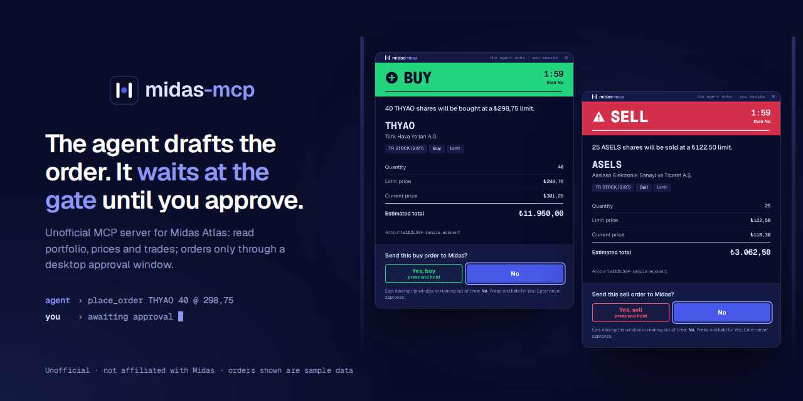
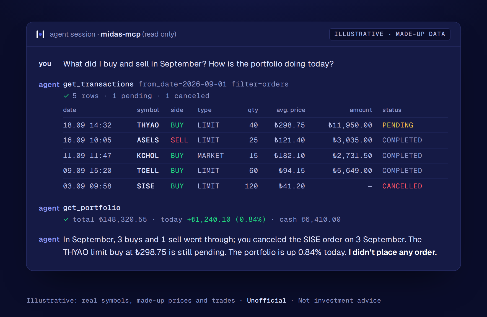
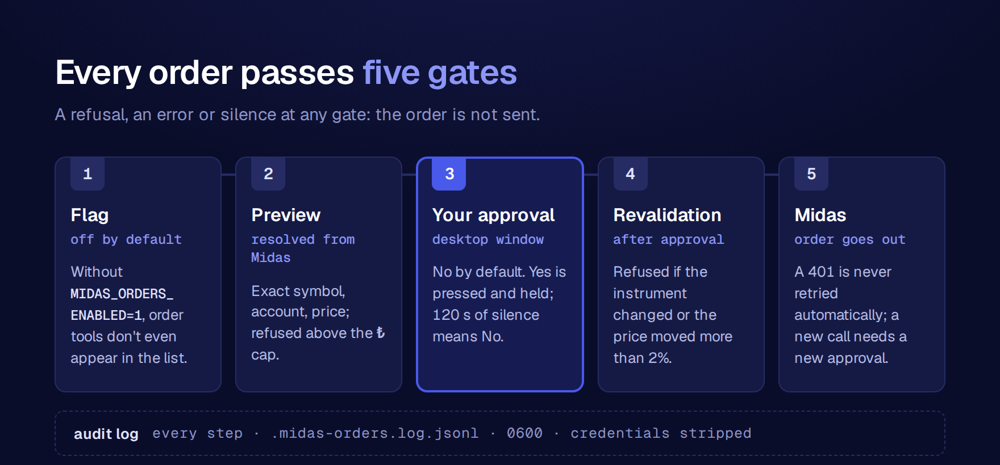
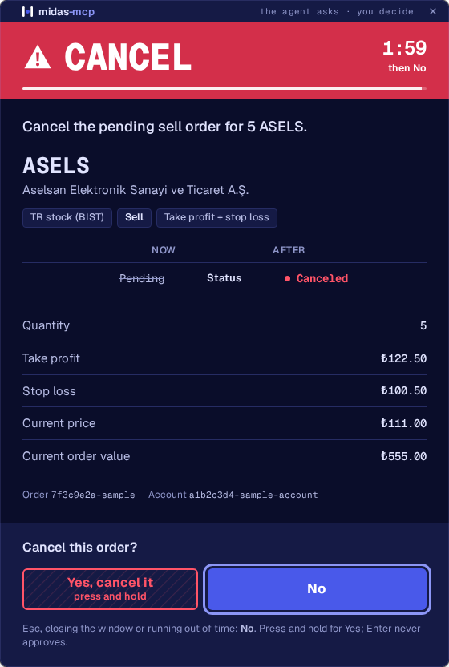
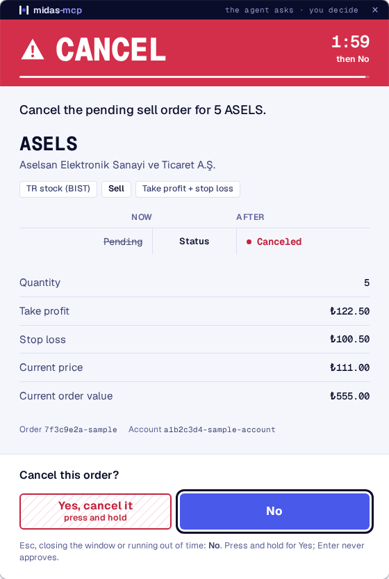

<h1>
  
  
</h1>

[Türkçe](README.md) · **English**

[](https://github.com/YakupEmreYerli/mcp-midas/actions/workflows/ci.yml) [](LICENSE) [](https://nodejs.org) [](#turning-on-order-tools) [](#unofficial)

**The agent reads the board and drafts the order. The order never reaches Midas until you approve it.**

An [MCP](https://modelcontextprotocol.io) server for [Atlas](https://atlas.getmidas.com/),
the web app of the Turkish brokerage Midas. It lets an AI assistant read your portfolio,
positions, transaction history and market data. Order tools are off by default; when
enabled, every order waits for your approval on the desktop.



## Unofficial

> [!WARNING]
> **Unofficial.** This project is not affiliated with Midas Menkul Değerler A.Ş. or Midas
> Finansal Teknolojiler A.Ş., and is not developed, endorsed or supported by them. The name
> "Midas" only says which service it works with; no Midas logo or branding is used.
>
> **Not investment advice.** The data and calculations the tools return (technical
> indicators included) are for information only. The software is provided as is, without
> any warranty.
>
> **Your own account only, at your own risk.** Under article 1.11 of the Midas framework
> agreement, the customer may not consent to third parties interfering with the electronic
> trading platform without Midas's permission; the agreement also expects only the customer
> to use the platform and the password never to be shared. This tool is meant to be run by
> account holders on their own computer for their own account. **Do not use it to manage
> someone else's account, trade on someone else's behalf or offer it as a service.** Read
> the current agreement yourself; this note is not legal advice.
>
> **Credentials stay local.** Your phone number, password and session file stay on your
> machine; the code only sends them to Midas's own login form.

## Features

- **Read tools.** Portfolio value, cash and buying power, open positions, live prices and
  instrument info for BIST stocks, US stocks and ETFs, and TEFAS funds, including ones you
  don't hold.
- **Transaction history.** The whole Atlas "İşlem geçmişi" (transaction history) screen:
  trades, TRY and FX transfers, dividends, interest and withholding tax, filtered by date,
  category and status.
- **Technical analysis.** RSI, moving averages, MACD, Bollinger Bands, ATR, volatility,
  support and resistance in one call; raw OHLCV candles separately.
- **Desktop approval gate.** With order tools on, every order, update and cancel opens a
  window on your screen. The default is No; Yes has to be pressed and held.
- **Orders off by default.** Without the flag, order tools don't even appear in the
  assistant's tool list.
- **Persistent session.** You approve the notification on your phone once; the session is
  saved, and if it drops the server recovers with a single login flow.
- **stdio or HTTP.** Connect it straight to an MCP client, or run it as a local service that
  shares one session between several clients.
- **Turkish and English.** Windows, notifications, tool descriptions and error messages come
  in both languages; the system locale or `MIDAS_LANG` picks one.



## Setup

You need Node.js 20+, a Linux desktop (for order approval), a Midas account and the Midas
app on your phone.

**1. Clone and build**

```bash
git clone https://github.com/YakupEmreYerli/mcp-midas.git
cd mcp-midas
npm ci
npx playwright install chromium
npm run build
```

**2. Pass credentials through the environment**

The server only reads `process.env`, so any secret manager that can inject environment
variables works. The simplest option is a gitignored `.env` file:

```bash
cp .env.example .env
```

```ini
MIDAS_PHONE=5XXXXXXXXX      # mobile number without the country code
MIDAS_PASSWORD=yourpassword # both optional; if empty, you type them in the login window
HEADLESS=true
MAX_ORDER_VALUE_TRY=10000   # extra cap; desktop approval is always required
# MIDAS_LOGIN_WINDOW=hidden # login browser: hidden | visible | headless
# MIDAS_LOGIN_METHOD=push   # verification: push (notification) | sms (you type the code into a window)
# MIDAS_KEEPALIVE_HOURS=4   # keep-alive interval for the HTTP service; 0 disables
# MIDAS_IDLE_CLOSE_MINUTES=10 # an idle browser closes after this many minutes; 0 disables
# MIDAS_ORDERS_ENABLED=1    # turns on the order tools (off by default)
# MIDAS_ACCOUNT_LABEL=personal # account name when you run several (see Several accounts)
# MIDAS_DATA_DIR=/absolute/path # directory for session and log files (default: project root)
# MIDAS_LANG=en             # interface language: tr | en (default: system locale, see Language)
```

**3. First login**

Midas asks you to approve a notification in the mobile app when you log in, so the first
login is interactive:

```bash
npm run login          # opens a visible browser; approve the notification on your phone
npm run smoke          # prints the portfolio, positions and one price
```

The session is written to `.midas-state.json` (0600, gitignored) and restored on later
starts. The refresh cookie lives a fixed 24 hours from login and refreshing doesn't extend
it; on the first tool call after it expires, the server logs in again by itself and your
phone gets another notification to approve. By default, the browser for that login stays
out of sight (see [Login window and keep-alive](#login-window-and-keep-alive)).

**4. Add it to your MCP client**

```bash
claude mcp add midas -- node /absolute/path/mcp-midas/dist/index.js
```

For clients that read a JSON configuration:

```json
{
  "mcpServers": {
    "midas": {
      "command": "node",
      "args": ["/absolute/path/mcp-midas/dist/index.js"]
    }
  }
}
```

**5. (Optional) Persistent HTTP service**

`dist/http.js` runs the server as Streamable HTTP on `127.0.0.1:8766`; the browser session
stays open and several clients share it. `/mcp` requests are authenticated with the bearer
token in `~/.config/mcp-midas/token` (created with 0600 permissions on first start);
`/health` needs no token. `MIDAS_HTTP_PORT` changes the port and `MIDAS_TOKEN_FILE` the token
file. Example systemd user service (`~/.config/systemd/user/midas-mcp.service`):

```ini
[Unit]
Description=Midas MCP (127.0.0.1:8766)
After=graphical-session.target
PartOf=graphical-session.target

[Service]
WorkingDirectory=/absolute/path/mcp-midas
# If you want the order tools:
# Environment=MIDAS_ORDERS_ENABLED=1
ExecStart=/usr/bin/env node dist/http.js
Restart=on-failure

[Install]
WantedBy=graphical-session.target
```

```bash
systemctl --user enable --now midas-mcp.service
```

The approval window needs a desktop, so the service must run inside the graphical session.
On Wayland the window opens as a native Wayland window (if that fails it falls back to
XWayland/X11; `MIDAS_ONAY_X11=1` forces X11). On KDE Plasma a temporary KWin script keeps
only the approval process's window on top and centres it; without KWin this step is skipped.
To make the desktop show the midas-mcp logo as the window icon, run once:

```bash
onay/masaustu-kur.sh          # ~/.local/share/applications/midas-mcp-onay.desktop (+ icon)
onay/masaustu-kur.sh --kaldir # to undo
```

### Language

The approval and SMS code windows, desktop notifications, tool descriptions, error messages
returned to the agent and log lines are in Turkish or English. `MIDAS_LANG` (`tr` or `en`)
picks the language. Without it the server looks at the system locale (`LC_ALL`, then
`LC_MESSAGES`, then `LANG`): anything starting with `tr` means Turkish, everything else
English. An invalid value stops the server at start-up.

The approval and SMS code windows use the language of the device that shows them. When a
window opens on another machine (over ssh, for example), it looks at that machine's locale:
`LC_ALL`, then `LC_MESSAGES`, then `LANG`; these are often empty in a window opened over ssh,
and then `LANG` from `/etc/locale.conf` (or `/etc/default/locale`) applies. If `MIDAS_LANG` is
set, the windows use that language too. Notifications, tool descriptions, error messages and
the kdialog/zenity fallbacks are produced on the server, so they use the server's language.

Tool names, argument names and JSON fields never change with the
language.

### Login window and keep-alive

Midas login asks for a notification approval on your phone, and the SSO form has a
Cloudflare Turnstile check that a headless browser can't pass reliably, so login runs in a
headed Chromium. `MIDAS_LOGIN_WINDOW` decides how that window opens:

| Value | Behaviour |
| --- | --- |
| `hidden` (default) | Chromium opens on XWayland (`--ozone-platform=x11`) with the window class `mcp-midas-login`. On KDE Plasma a temporary KWin script minimizes only windows of that class, moves them off-screen, makes them transparent and hides them from the taskbar; it is removed when login ends. Without KWin the window is minimized over CDP. Once the form is sent, a desktop notification (`notify-send`) asks you to approve the Midas notification on your phone. If the check doesn't pass on its own within 30 s, the window comes forward and a notification tells you. |
| `visible` | The old behaviour: a normal, visible browser window. |
| `headless` | Experimental. Fills the form in full Chromium's new headless mode. If Turnstile doesn't pass within 20 s, it falls back to `hidden` **without sending** the form (no notification reaches your phone). |

`MIDAS_LOGIN_METHOD=sms` switches the second step from the phone notification to an SMS
code, for accounts where approving the notification fails with "geçersiz imza" (invalid
signature). On the mobile approval screen the server picks "SMS ile giriş yap" (sign in with
SMS) and waits up to 8 minutes for the code:

- With a local desktop, the code is asked in the SMS code window (`onay/sms.py`), which looks
  like the approval window. It accepts digits only (4-8), Enter sends; Esc, closing it or
  running out of time cancels. The server types the code into the login page itself and never
  logs it.
- `MIDAS_SMS_CODE_COMMAND` (JSON array) sets the command that asks for the code; if set, it
  replaces the local window. The command gets `{"hesapEtiketi": …, "sureSn": …, "dil": …}`
  (account label, seconds left, language) on stdin and prints the code on stdout with exit
  code 0; any other result counts as cancel. For example
  `["python3", "/absolute/path/mcp-midas/onay/sms.py"]`, or
  `["ssh", "user@desktop", "python3", "/absolute/path/mcp-midas/onay/sms.py"]` to ask on
  another machine.
- If no window opens or you cancel it, the Midas browser window comes forward and you type
  the code there.

`npm run login` always uses a visible window; with `HEADLESS=false` login is visible too.

The HTTP service probes the session headless one minute after start and then every
`MIDAS_KEEPALIVE_HOURS` hours (default 4; `0` disables): if the browser is closed it opens
the saved session headless, sends a harmless read query, reloads the page once on a 401 to
trigger the app's token refresh, and saves `storageState`. If the session has dropped it
does **not** start a login; it only logs, and login waits for the next real tool call. The
log line contains no token values, only times:

```bash
journalctl --user -u midas-mcp.service | grep keepAlive
```

Keep-alive refreshes the short-lived `access_token` (~15 min) and keeps the saved snapshot
fresh; it doesn't extend the 24-hour limit of the `refresh_token`. You still approve one
notification a day; the window just no longer appears on screen.

The browser doesn't stay open while idle: `MIDAS_IDLE_CLOSE_MINUTES` minutes after the last
tool call (default 10; `0` disables) it saves the latest tokens and closes. The next call
reopens the saved session headless and quietly; while the session is still valid, no new
login is needed. Keep-alive also closes a browser it opened only to probe.

### Turning on order tools

The order tools are registered only when this environment variable is **exactly `1`**:

```ini
MIDAS_ORDERS_ENABLED=1
```

Without it (or with any other value, such as `true` or `yes`), `place_order`,
`update_order` and `cancel_order` don't appear in the MCP tool list at all; the assistant
can't call them and doesn't know they exist. The flag only decides whether the tools exist.
Even when it's on, no order is sent without the approval window.

### Several accounts

You can use more than one Midas account on the same machine, for example your own and the
account of a child under 18 that you manage. Each account is its own process; credentials,
data directory, port and token are never shared:

| Variable | What it does |
| --- | --- |
| `MIDAS_DATA_DIR` | Directory for the browser profile, `.midas-state.json` and the order audit log (absolute path, `~/` allowed; created with 0700 permissions). Defaults to the project root |
| `MIDAS_ACCOUNT_LABEL` | Short account name (up to 40 characters). Shown in the server name (`midas-mcp (child)`), the instructions given to the agent, every tool result, the approval window's strip and title, the kdialog/zenity fallbacks and login notifications |
| `MIDAS_HTTP_PORT`, `MIDAS_TOKEN_FILE` | A separate port and token per account for the HTTP service |

The account line in a tool result (`Account: child`, or `Hesap: child` in Turkish) comes as
a separate part after the JSON; the first part always stays pure JSON. Two accounts over
stdio:

```bash
claude mcp add midas-personal -e MIDAS_ACCOUNT_LABEL=personal -e MIDAS_DATA_DIR=~/.local/share/mcp-midas/personal \
  -e MIDAS_PHONE=5XXXXXXXXX -e MIDAS_PASSWORD=... -- node /absolute/path/mcp-midas/dist/index.js
claude mcp add midas-child -e MIDAS_ACCOUNT_LABEL=child -e MIDAS_DATA_DIR=~/.local/share/mcp-midas/child \
  -e MIDAS_PHONE=5YYYYYYYYY -e MIDAS_PASSWORD=... -- node /absolute/path/mcp-midas/dist/index.js
```

Rather than typing the password on the command line, you can use your secret manager. For
the HTTP service, write a separate systemd unit per account and give each its own
`MIDAS_HTTP_PORT` and `MIDAS_TOKEN_FILE`.

### Approving on another machine (optional)

By default the approval window opens only on the screen of the machine running the server,
and none of the settings in this section turns on by itself. If you run the server on a
machine whose screen you don't watch (for example a small server at home), or want the window
to open on one more machine at the same time, you can set these commands in the service
environment. All are JSON arrays; no shell is involved:

| Variable | What it does |
| --- | --- |
| `MIDAS_CONFIRM_REMOTE` | A command that also opens the approval window somewhere else. Both windows open at once; the first Yes, No or timeout given in a shown window decides, and the other window is closed |
| `MIDAS_CONFIRM_REMOTE_CLOSE` | Optional: a command that closes the remote window when the decision came from the other one (dropping the connection may not reach it) |
| `MIDAS_CONFIRM_LOCAL` | Replaces the local approval window command. This machine then needs no display, and the kdialog and zenity fallbacks are skipped |
| `MIDAS_CONFIRM_LOCAL_CLOSE` | Optional: a command that closes the window opened through `MIDAS_CONFIRM_LOCAL` |

The command must run **the same approval window** (`onay/onay.py`) on the other machine: the
server passes the preview on stdin and reads the output with the same strict rule as the
local window. Only the `ACILDI` line together with `SONUC evet` and exit code 0 is a Yes;
everything else is No or an error. Example (the other machine also has this repository and
PySide6 installed; the key decides which command runs, see the trust model):

```ini
Environment='MIDAS_CONFIRM_REMOTE=["ssh","-i","/etc/mcp-midas/onay_ed25519","user@desktop"]'
```

A window that never opens (machine off, ssh can't connect) isn't waited for, and the other
window's answer counts; if neither side opens, the result is an error and the order isn't
sent. An invalid value isn't ignored: every approval request then fails as an error. The
audit log records which window decided (`onay` or `onay-remote`) and the configured command
itself. For the trust model, read
[Approving on another machine: trust model](#approving-on-another-machine-trust-model) below.

## Tools

### Read (always on)

| Tool | Arguments | Returns |
| --- | --- | --- |
| `get_session_status` | – | Whether the session is open (`logged-in`, `logged-out`, `starting`) and when the `refresh_token` expires. Never starts a login; if the browser is closed and there's no saved session, or it has expired, it doesn't open a browser either |
| `get_portfolio` | – | Total value in TRY, the day's profit/loss, cash and buying power per account (TRY / USD / EUR) |
| `get_assets` | – | All open positions: quantity, average cost, price, market value, profit/loss |
| `get_asset_price` | `symbol`, optional `currency`, `market` | Last price, previous close, % change, session status |
| `get_asset_info` | `symbol`, optional `market` | Instrument name, market, description, current price and Atlas statistics (TEFAS: risk, settlement days, tax, management fee; stocks: daily band, 52-week range, ratios). `exactMatch` flags a fuzzy match |
| `get_pending_orders` | `symbol?`, `market?` | Pending orders; without `symbol`, those of all accounts in one call |
| `get_transactions` | `from_date?`, `to_date?`, `status?`, `filter?`, `details?`, `limit?`, `offset?` | Account activity: stock/ETF/fund trades, TRY transfers, FX, interest, withholding tax, dividends. Default: the last 30 days |
| `get_transaction_filters` | – | Category IDs for `get_transactions` |
| `get_technicals` | `symbol`, optional `interval`, `market` | RSI(14), SMA/EMA (20/50/200), MACD, Bollinger Bands, ATR, annualized volatility, 52-week range, support/resistance, volume vs. average |
| `get_chart` | `symbol`, optional `interval`, `limit`, `market` | Raw OHLCV candles (at most 500) |

> **Symbol lookup for reads is fuzzy.** Symbols are found through search, and an unknown code
> falls back to the closest match instead of failing: asking for `VOO` may return the `IOO`
> fund, and `TTE` may return TotalEnergies instead of the Turkish fund with the same code.
> Check the `name` and `currency` fields in the reply. Order tools require an exact symbol and
> reject fuzzy matches.
>
> **Several instruments can share a symbol** (e.g. `GTM`: a TEFAS fund and ZoomInfo on
> NASDAQ). Then the instrument you hold wins; if your positions don't tell them apart, read
> tools return Midas's first exact match with `ambiguousSymbol` and a `candidates` list, and
> the optional `market` hint (`TR` or `US`) picks the other one. Order tools don't guess in
> this case: they refuse and list the candidates (name, market, country, type). Updates and
> cancels go by the order's own instrument.

### Orders (off by default)

| Tool | Arguments | What it does |
| --- | --- | --- |
| `place_order` | exact `symbol`, `side`, optional `order_type`, `quantity`, `amount_try`, `limit_price`, `take_profit_price`, `stop_loss_price` | A MARKET/LIMIT order for a BIST stock, a take-profit/stop-loss sell order for a BIST stock you hold (`TAKE_PROFIT_AND_STOP_LOSS`, `TAKE_PROFIT`, `STOP_LOSS`), and a DEMAND sell order for a TEFAS fund (with `quantity`) |
| `update_order` | `order_id`, exact `symbol`, changed quantity/prices | Updates a pending LIMIT/STOP/take-profit/stop-loss order; if Midas doesn't allow it (`showUpdate: false`), it explains how to cancel and place the order again |
| `cancel_order` | `order_id`, exact `symbol` | Cancels an eligible pending order |

TEFAS fund sells are supported as a `DEMAND` order by quantity. Fund buys are refused: Midas
Atlas has no TEFAS buying (Midas turns the request down with "Talep emri şu anda
verilemiyor", "demand orders can't be placed right now"), so funds can only be bought in the
Midas phone app.

Midas doesn't allow updating existing take-profit/stop-loss orders (`showUpdate: false`). To
change the prices, cancel the order with `cancel_order`, then place it again with
`place_order`, giving `side: "SELL"`, `quantity`, `take_profit_price` and `stop_loss_price`.
Each step needs its own approval, and the position is unprotected in between. The request
fields match what the take-profit/stop-loss sell form in the Atlas web bundle sends.

## Security



- **Approval window.** Every order tool resolves the instrument and account from Midas,
  builds the preview from that data and opens a local window in the MCP server's own
  process: the designed window (`onay/onay.py`, PySide6 + QtWebEngine, preview on stdin, no
  network access); if it can't open, `kdialog --menu`, and if that can't open either,
  `zenity`.
- **No by default.** Yes is given by pressing and holding; Enter never approves. Esc,
  closing the window or 120 seconds of silence mean No. Approvals queue up; only one window
  shows at a time.
- **An error is not a refusal.** With no display, or if the window can't open, the order is
  still refused, but it's reported as an "approval window couldn't open" error, not as the
  user saying No.
- **No bypass channel.** The MCP interface has no `confirmed`, `approve` or any other
  argument, environment variable or setting that skips the approval.
- **Revalidation after approval.** The server resolves the symbol and current price again;
  if the instrument changed or the price moved more than 2%, the order is dropped. The
  `MAX_ORDER_VALUE_TRY` cap (default ₺10,000) is an extra limit, not a substitute for
  approval. If an order request gets a 401, it isn't retried automatically; a new call
  needs a new approval.
- **Audit log.** Every attempt and its outcome is written to `.midas-orders.log.jsonl` with
  0600 permissions, with credential-like fields stripped; it also records which window opened
  and, if set, the approval command.

<p>
  
  
</p>

<sub>The windows were captured with sample data; account and order IDs are not real.</sub>

### Approving on another machine: trust model

The default promise is this: an order is approved only in a window on the machine running
the server. Setting `MIDAS_CONFIRM_REMOTE` or `MIDAS_CONFIRM_LOCAL` moves that trust. The
command is trusted like the local window; the server doesn't second-guess its output, it
only checks that it follows the protocol. From then on, approvals are decided by:

- anyone who can change the service configuration (systemd unit, `.env`),
- anyone who controls the other machine,
- whatever controls the link between the two machines (for example ssh keys).

These settings are never read from a tool schema, an MCP request or a file that can change
at run time; they come only from the server process's environment at start-up. The agent
can neither see nor change them. Still, whoever writes the command could just as well write
a script that answers Yes instead of showing a window; what prevents that isn't the code but
who can touch the service configuration.

If you use ssh, create a key just for this and lock it to a single command in the other
machine's `authorized_keys`:

```text
command="/usr/bin/python3 /absolute/path/mcp-midas/onay/onay.py",no-port-forwarding,no-agent-forwarding,no-X11-forwarding,no-pty ssh-ed25519 AAAA... midas-onay
```

The command has to reach the graphical session on the other machine (`DISPLAY`/
`WAYLAND_DISPLAY`); a small wrapper started from that machine's own session solves this. If
you also want the SMS code window there, give it a separate key with its own `command=`.

The approval window was written for the Linux desktop. Where no window can open, the order
tools can't send any order. Sensitive files, scope and how to report a vulnerability:
[SECURITY.en.md](SECURITY.en.md).

## How it works

Midas has no public API. The server drives the Atlas web app with
[Playwright](https://playwright.dev): it keeps one logged-in browser and makes the same
GraphQL calls as the web app from inside the page (`page.evaluate`), so session cookies are
attached automatically. Because it relies on undocumented internal endpoints, it can break
without warning when Midas changes something.

Atlas keeps the identity in the `access_token` (~15 min) and `refresh_token` (24 h) cookies,
and Chromium doesn't write them to the profile; that's why the session is saved with
`storageState()` after every successful start, on keep-alive rounds and at shutdown. The open
page renews the `access_token` itself a minute before it expires; renewing doesn't change the
`refresh_token` or extend it (it still expires 24 hours after login). A read request that gets
a 401/403 is retried once after the shared login flow. Details such as the `x-midas-rid` and
`x-apollo-operation-name` headers the gateway expects are in the "Repository pitfalls" section
of [CONTRIBUTING.en.md](CONTRIBUTING.en.md).

## Documentation

| Document | Covers |
| --- | --- |
| [METHOD.en.md](METHOD.en.md) | Formulas and data source behind the `get_technicals` indicators |
| [docs/analiz-kurallari.en.md](docs/analiz-kurallari.en.md) | Guidelines the agent follows when analysing a stock or fund |
| [docs/brand](docs/brand/README.md) | Brand kit: logo, colours, type, voice, relationship with Midas (Turkish) |
| [CONTRIBUTING.en.md](CONTRIBUTING.en.md) | Setup, pre-submit commands, repository pitfalls |
| [SECURITY.en.md](SECURITY.en.md) | Vulnerability reporting, sensitive files, measures in place |
| [CHANGELOG.md](CHANGELOG.md) | What changed in each release and what you need to do |
| [RELEASES.md](RELEASES.md) | What a version number promises, what counts as breaking, supported versions |
| [DESIGN.md](DESIGN.md) | The approval window's design system (Turkish) |

## Development

```bash
npm test         # unit tests; never connect to Midas or send real orders
npm run build
```

No real orders are sent during development or testing; the agent rules are in
[AGENTS.md](AGENTS.md) (Turkish).

## License

[MIT](LICENSE). Brand assets and font licenses are in [docs/brand](docs/brand/README.md).
