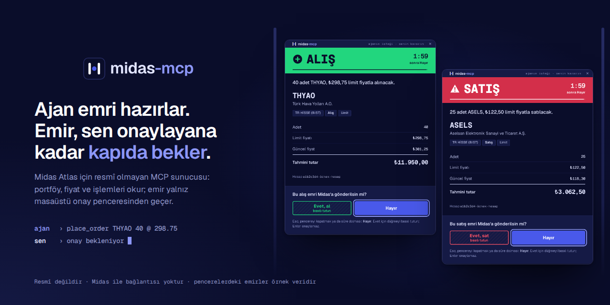
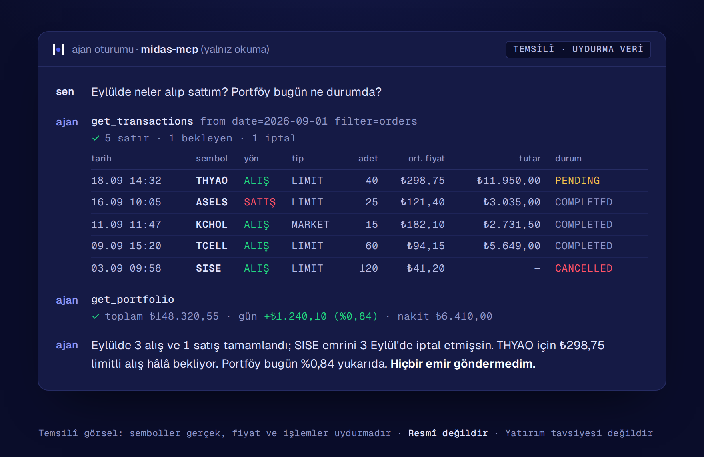
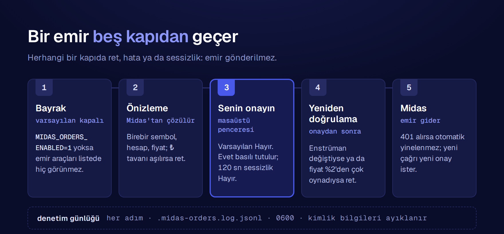
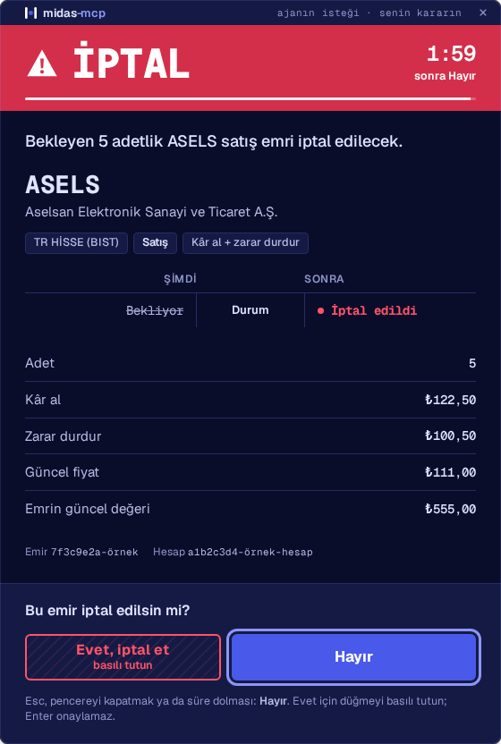
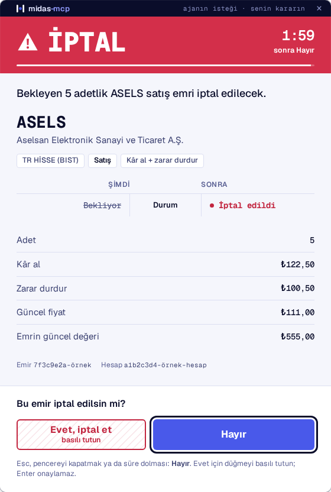

<h1>
  
  
</h1>

**Türkçe** · [English](README.en.md)

[](https://github.com/YakupEmreYerli/mcp-midas/actions/workflows/ci.yml) [](LICENSE) [](https://nodejs.org) [](#emir-araçlarını-açmak) [](#resmî-değildir)

**Ajan tahtayı okur, emri hazırlar. Emir, sen onaylamadan Midas'a gitmez.**

Midas aracı kurumunun web uygulaması [Atlas](https://atlas.getmidas.com/) için bir
[MCP](https://modelcontextprotocol.io) sunucusu. Bir AI asistanın portföyünü,
pozisyonlarını, işlem geçmişini ve piyasa verisini okumasını sağlar. Emir araçları
varsayılan kapalıdır; açıldığında da her emir masaüstünde senin onayını bekler.



## Resmî değildir

> [!WARNING]
> **Resmî değildir.** Bu proje Midas Menkul Değerler A.Ş. ya da Midas Finansal Teknolojiler
> A.Ş. ile bağlantılı değildir; onlar tarafından geliştirilmez, onaylanmaz, desteklenmez.
> "Midas" adı yalnızca hangi hizmetle çalıştığını söylemek için geçer; Midas logosu ve
> marka öğeleri kullanılmaz.
>
> **Yatırım tavsiyesi değildir.** Araçların döndürdüğü veri ve hesaplamalar (teknik
> göstergeler dahil) bilgi amaçlıdır. Yazılım olduğu gibi, hiçbir garanti olmadan sunulur.
>
> **Yalnız kendi hesabında, kendi riskinle.** Midas Genel Çerçeve Sözleşmesi m. 1.11'e göre
> müşteri, Midas'ın izni olmadan Elektronik İşlem Platformu'na üçüncü şahısların
> müdahalesine rıza gösteremez; sözleşme ayrıca platformun yalnızca müşterinin kendisi
> tarafından kullanılmasını ve şifrenin kimseyle paylaşılmamasını ister. Bu araç, hesap
> sahibinin kendi bilgisayarında kendi hesabı için çalıştırması içindir. **Başkasının
> hesabını yönetmek, başkası adına işlem yapmak ya da bunu hizmet olarak sunmak için
> kullanılmaz.** Sözleşmenin güncel hâlini kendin oku; bu not hukuki görüş değildir.
>
> **Kimlik bilgileri yalnız yerelde kalır.** Telefon, şifre ve oturum dosyası senin
> makinende durur; kod bunları yalnızca Midas'ın kendi giriş formuna gönderir.

## Özellikler

- **Okuma araçları.** Portföy değeri, nakit ve alım gücü, açık pozisyonlar, anlık fiyat ve
  enstrüman bilgisi; BIST hisseleri, ABD hisse ve ETF'leri, TEFAS fonları, elinde olmayanlar
  dahil.
- **İşlem geçmişi.** Atlas'taki "İşlem geçmişi" ekranının tamamı: alış satışlar, TL ve döviz
  hareketleri, temettü, nema, stopaj; tarih, kategori ve duruma göre süzülür.
- **Teknik analiz.** RSI, hareketli ortalamalar, MACD, Bollinger, ATR, oynaklık, destek ve
  direnç tek çağrıda; ham OHLCV mumları ayrıca.
- **Masaüstü onay kapısı.** Emir araçları açıksa her emir, güncelleme ve iptal senin
  ekranında bir pencere açar. Varsayılan Hayır'dır; Evet basılı tutularak verilir.
- **Emirler varsayılan kapalı.** Bayrak verilmezse emir araçları asistanın araç listesinde
  hiç görünmez.
- **Kalıcı oturum.** Telefondaki bildirimi bir kez onaylarsın; oturum saklanır, düşerse
  sunucu tek bir giriş akışıyla kendini toparlar.
- **stdio ya da HTTP.** Doğrudan MCP istemcisine bağlanır ya da yerelde kalıcı bir servis
  olarak birden çok istemciye aynı oturumu paylaştırır.
- **Türkçe ve İngilizce.** Pencereler, bildirimler, araç açıklamaları ve hata mesajları iki
  dilde; dil sistem yerelinden ya da `MIDAS_LANG` ile seçilir.



## Kurulum

Gerekenler: Node.js 20+, Linux masaüstü (emir onayı için), Midas hesabı ve telefonundaki
Midas uygulaması.

**1. Klonla ve derle**

```bash
git clone https://github.com/YakupEmreYerli/mcp-midas.git
cd mcp-midas
npm ci
npx playwright install chromium
npm run build
```

**2. Kimlik bilgilerini ortamla ver**

Sunucu yalnızca `process.env` okur; ortam değişkeni enjekte edebilen herhangi bir sır
yöneticisi çalışır. En basit yol gitignore'lu bir `.env` dosyası:

```bash
cp .env.example .env
```

```ini
MIDAS_PHONE=5XXXXXXXXX      # ülke kodu olmadan cep telefonu
MIDAS_PASSWORD=sifren       # ikisi de isteğe bağlı; boşsa giriş penceresinde kendin yazarsın
HEADLESS=true
MAX_ORDER_VALUE_TRY=10000   # ek tavan; masaüstü onayı her zaman gerekir
# MIDAS_LOGIN_WINDOW=hidden # giriş tarayıcısı: hidden | visible | headless
# MIDAS_LOGIN_METHOD=push   # doğrulama: push (bildirim) | sms (kodu bir pencereye sen yazarsın)
# MIDAS_KEEPALIVE_HOURS=4   # HTTP servisinde canlı tutma aralığı; 0 kapatır
# MIDAS_IDLE_CLOSE_MINUTES=10 # boştaki tarayıcı bu kadar dakika sonra kapanır; 0 kapatır
# MIDAS_ORDERS_ENABLED=1    # emir araçlarını açar (varsayılan kapalı)
# MIDAS_ACCOUNT_LABEL=personal # birden çok hesapta hesabın adı (bkz. Birden çok hesap)
# MIDAS_DATA_DIR=/mutlak/yol # oturum ve günlük dosyalarının dizini (varsayılan proje kökü)
# MIDAS_LANG=tr             # arayüz dili: tr | en (varsayılan sistem yereli, bkz. Dil)
```

**3. İlk giriş**

Midas girişte mobil uygulamada bildirim onayı ister, bu yüzden ilk giriş etkileşimlidir:

```bash
npm run login          # görünür tarayıcı açar; telefondaki bildirimi onayla
npm run smoke          # portföyü, pozisyonları ve bir fiyatı yazdırır
```

Oturum `.midas-state.json` dosyasına (0600, gitignore'lu) yazılır ve sonraki açılışlarda
geri yüklenir. Yenileme çerezinin ömrü girişten itibaren sabit 24 saattir ve yenilemeyle
uzamaz; dolduktan sonraki ilk araç çağrısında sunucu kendi kendine yeniden giriş yapar ve
telefona yine bildirim onayı düşer. Bu girişin tarayıcısı varsayılan olarak göz önünde
açılmaz (bkz. [Giriş penceresi ve canlı tutma](#giriş-penceresi-ve-canlı-tutma)).

**4. MCP istemcisine ekle**

```bash
claude mcp add midas -- node /mutlak/yol/mcp-midas/dist/index.js
```

JSON yapılandırması okuyan istemciler için:

```json
{
  "mcpServers": {
    "midas": {
      "command": "node",
      "args": ["/mutlak/yol/mcp-midas/dist/index.js"]
    }
  }
}
```

**5. (İsteğe bağlı) Kalıcı HTTP servisi**

`dist/http.js` sunucuyu `127.0.0.1:8766` üzerinde Streamable HTTP olarak çalıştırır;
tarayıcı oturumu açık kalır ve birden çok istemci aynı oturumu paylaşır. `/mcp` istekleri
`~/.config/mcp-midas/token` dosyasındaki (ilk açılışta 0600 izinle üretilir) bearer token
ile doğrulanır; `/health` doğrulama istemez. Port `MIDAS_HTTP_PORT`, token dosyası
`MIDAS_TOKEN_FILE` ile değişir. Örnek systemd kullanıcı servisi
(`~/.config/systemd/user/midas-mcp.service`):

```ini
[Unit]
Description=Midas MCP (127.0.0.1:8766)
After=graphical-session.target
PartOf=graphical-session.target

[Service]
WorkingDirectory=/mutlak/yol/mcp-midas
# Emir araçlarını istiyorsan:
# Environment=MIDAS_ORDERS_ENABLED=1
ExecStart=/usr/bin/env node dist/http.js
Restart=on-failure

[Install]
WantedBy=graphical-session.target
```

```bash
systemctl --user enable --now midas-mcp.service
```

Onay penceresi masaüstü ister; servis grafik oturumuna bağlı çalışmalıdır. Wayland
oturumunda pencere yerel Wayland penceresi olarak açılır (Wayland açılamazsa XWayland/X11'e
düşer; `MIDAS_ONAY_X11=1` X11'i zorlar). KDE Plasma'da KWin'e geçici bir betik yüklenir:
betik yalnız onay sürecinin penceresini üstte tutar ve ekranın ortasına alır; KWin yoksa bu
adım atlanır. Pencere simgesinin masaüstünde midas-mcp logosu olarak görünmesi için bir kez:

```bash
onay/masaustu-kur.sh          # ~/.local/share/applications/midas-mcp-onay.desktop (+ simge)
onay/masaustu-kur.sh --kaldir # geri almak için
```

### Dil

Onay ve SMS kodu pencereleri, masaüstü bildirimleri, araç açıklamaları, ajana dönen hata
mesajları ve loglar Türkçe ya da İngilizcedir. Dili `MIDAS_LANG` (`tr` ya da `en`) seçer.
Verilmezse sistem yereline bakılır (sırasıyla `LC_ALL`, `LC_MESSAGES`, `LANG`): `tr` ile
başlıyorsa Türkçe, değilse İngilizce. Geçersiz bir değer sunucuyu açılışta durdurur.

Onay ve SMS kodu pencereleri ise açıldıkları cihazın dilini kullanır. Pencere başka bir
makinede açılıyorsa (örneğin ssh ile) o makinenin yereline bakar: önce `LC_ALL`, `LC_MESSAGES`,
`LANG`; ssh ile açılan pencerede bunlar çoğu zaman boştur, o zaman `/etc/locale.conf` (yoksa
`/etc/default/locale`) içindeki `LANG` geçerlidir. `MIDAS_LANG` verilmişse pencereler de o dilde
açılır. Bildirimler, araç açıklamaları, hata mesajları ve kdialog/zenity yedekleri sunucuda
üretildiği için sunucunun dilindedir.

Araç adları, argüman adları ve JSON alanları dile göre değişmez.

### Giriş penceresi ve canlı tutma

Midas girişi telefonda bildirim onayı ister ve SSO formunda Cloudflare Turnstile
doğrulaması vardır; başsız tarayıcı bu doğrulamayı güvenilir biçimde geçemediği için giriş
görünür (headed) bir Chromium'la yapılır. `MIDAS_LOGIN_WINDOW` bu pencerenin nasıl
açılacağını belirler:

| Değer | Davranış |
| --- | --- |
| `hidden` (varsayılan) | Chromium XWayland'da (`--ozone-platform=x11`) `mcp-midas-login` sınıfıyla açılır. KDE Plasma'da KWin'e geçici bir betik yüklenir: betik yalnız bu sınıftaki pencereyi küçültür, ekran dışına alır, saydam yapar ve görev çubuğundan gizler; giriş bitince kaldırılır. KWin yoksa pencere CDP ile simge durumuna küçültülür. Form gönderilince masaüstüne "Telefonundaki Midas bildirimini onayla" bildirimi (`notify-send`) düşer. Doğrulama 30 sn içinde kendiliğinden geçmezse pencere öne getirilir ve bildirimle haber verilir. |
| `visible` | Eski davranış: normal, görünür tarayıcı penceresi. |
| `headless` | Deneysel. Form tam Chromium'un yeni başsız kipiyle doldurulur. Turnstile 20 sn içinde geçmezse form **gönderilmeden** (telefona bildirim gitmeden) `hidden` kipine düşülür. |

`MIDAS_LOGIN_METHOD=sms` ikinci adımı telefon bildiriminden SMS koduna çevirir. Bildirim
onayının "geçersiz imza" verdiği hesaplar için. Mobil onay ekranında "SMS ile giriş yap"
seçilir ve kod 8 dakika beklenir:

- Yerel masaüstü varsa kod, onay penceresiyle aynı görünümdeki SMS kodu penceresiyle
  (`onay/sms.py`) sorulur. Yalnız rakam kabul eder (4-8 hane), Enter gönderir; Esc, kapatma
  ya da süre dolması iptal demektir. Sunucu kodu giriş sayfasına kendisi yazar, kod loga
  girmez.
- `MIDAS_SMS_CODE_COMMAND` (JSON dizi) kodu soracak komutu belirler; verilirse yerel pencerenin
  yerine geçer. Komut stdin'den `{"hesapEtiketi": …, "sureSn": …, "dil": …}` alır, kodu stdout'a
  yazıp 0 ile çıkar; başka her sonuç iptaldir. Örnek: `["python3", "/mutlak/yol/mcp-midas/onay/sms.py"]`
  ya da başka bir makinede açmak için `["ssh", "kullanici@masaustu", "python3", "/mutlak/yol/mcp-midas/onay/sms.py"]`.
- Pencere açılamazsa ya da iptal edilirse Midas tarayıcı penceresi öne getirilir, kodu oraya
  yazarsın.

`npm run login` her zaman görünür pencere kullanır; `HEADLESS=false` verildiğinde de giriş
görünür yapılır.

HTTP servisi açılıştan bir dakika sonra ve ardından her `MIDAS_KEEPALIVE_HOURS` saatte bir
(varsayılan 4; `0` kapatır) oturumu başsız yoklar: tarayıcı kapalıysa kayıtlı durumla
başsız açar, zararsız bir okuma sorgusu atar, 401 alırsa sayfayı bir kez yeniden yükleyip
uygulamanın token yenilemesini tetikler ve `storageState`'i kaydeder. Oturum düşmüşse giriş
**başlatmaz**, yalnız loglar; giriş bir sonraki gerçek araç çağrısına kalır. Log satırı
token değeri içermez, yalnız süreleri yazar:

```bash
journalctl --user -u midas-mcp.service | grep keepAlive
```

Canlı tutma kısa ömürlü `access_token`'ın (~15 dk) yenilenmesini ve anlık görüntünün taze
kalmasını sağlar; `refresh_token`'ın 24 saatlik sınırını uzatmaz. Yani günde bir bildirim
onayı yine gerekir, yalnız artık ekrana pencere gelmez.

Tarayıcı boşta açık kalmaz: son araç çağrısından `MIDAS_IDLE_CLOSE_MINUTES` dakika sonra
(varsayılan 10; `0` kapatır) son token'ları kaydedip kapanır. Sonraki çağrı kayıtlı oturumu
başsız ve sessizce yeniden açar; oturum hâlâ geçerliyse yeni giriş istenmez. Canlı tutma da
yalnız yoklamak için açtığı tarayıcıyı iş bitince kapatır.

### Emir araçlarını açmak

Emir araçları yalnız şu ortam değişkeni **tam olarak `1`** ise kaydedilir:

```ini
MIDAS_ORDERS_ENABLED=1
```

Değişken yoksa (ya da `true`, `yes` gibi başka bir değerse) `place_order`, `update_order`
ve `cancel_order` MCP araç listesinde hiç görünmez; asistan bunları çağıramaz,
varlıklarını da bilmez. Bayrak yalnız araçların var olup olmadığını belirler. Açıkken de
hiçbir emir onay penceresi olmadan gönderilmez.

### Birden çok hesap

Aynı makinede birden çok Midas hesabı kullanılabilir; örneğin kendi hesabın ve 18 yaşından
küçük bir çocuğun senin yönettiğin hesabı. Her hesap ayrı bir süreçtir; kimlik bilgisi,
veri dizini, port ve token paylaşılmaz:

| Değişken | Ne yapar |
| --- | --- |
| `MIDAS_DATA_DIR` | Tarayıcı profili, `.midas-state.json` ve emir günlüğünün dizini (mutlak yol, `~/` kabul edilir; 0700 izinle kurulur). Verilmezse proje kökü |
| `MIDAS_ACCOUNT_LABEL` | Hesabın kısa adı (en çok 40 karakter). Sunucu adında (`midas-mcp (child)`), ajana verilen yönergede, her araç sonucunda, onay penceresinin şeridinde ve başlığında, kdialog/zenity yedeklerinde ve giriş bildirimlerinde görünür |
| `MIDAS_HTTP_PORT`, `MIDAS_TOKEN_FILE` | HTTP servisinde her hesaba ayrı port ve token |

Araç sonucunda hesap satırı (`Hesap: child`, İngilizcede `Account: child`) JSON'dan sonra
ayrı bir parça olarak gelir; ilk parça her zaman saf JSON kalır. stdio ile iki hesap:

```bash
claude mcp add midas-personal -e MIDAS_ACCOUNT_LABEL=personal -e MIDAS_DATA_DIR=~/.local/share/mcp-midas/personal \
  -e MIDAS_PHONE=5XXXXXXXXX -e MIDAS_PASSWORD=... -- node /mutlak/yol/mcp-midas/dist/index.js
claude mcp add midas-child -e MIDAS_ACCOUNT_LABEL=child -e MIDAS_DATA_DIR=~/.local/share/mcp-midas/child \
  -e MIDAS_PHONE=5YYYYYYYYY -e MIDAS_PASSWORD=... -- node /mutlak/yol/mcp-midas/dist/index.js
```

Şifreyi komut satırına yazmak yerine sır yöneticini kullanabilirsin. HTTP serviste her hesap
için ayrı bir systemd birimi yaz; `MIDAS_HTTP_PORT` ve `MIDAS_TOKEN_FILE`'ı da ayır.

### Onay penceresini başka bir makinede açmak (isteğe bağlı)

Varsayılan olarak onay penceresi yalnız sunucunun çalıştığı makinenin ekranında açılır ve bu
bölümdeki ayarların hiçbiri kendiliğinden açılmaz. Sunucuyu ekranına bakmadığın bir makinede
çalıştırıyorsan (örneğin evdeki küçük bir sunucu) ya da pencerenin aynı anda bir makinede daha
açılmasını istiyorsan, servis ortamında şu komutları verebilirsin. Hepsi JSON dizidir, kabuk
kullanılmaz:

| Değişken | Ne yapar |
| --- | --- |
| `MIDAS_CONFIRM_REMOTE` | Onay penceresini başka bir yerde de açan komut. Pencere burada ve orada aynı anda açılır; gösterilen bir pencerede verilen ilk Evet, Hayır ya da zaman aşımı karar olur, öteki pencere kapatılır |
| `MIDAS_CONFIRM_REMOTE_CLOSE` | İsteğe bağlı: karar öteki pencereden gelince uzaktaki pencereyi kapatan komut (bağlantıyı kesmek ona ulaşmayabilir) |
| `MIDAS_CONFIRM_LOCAL` | Yerel onay penceresi komutunun yerine geçer. O zaman bu makinede ekran gerekmez, kdialog ve zenity yedekleri çalışmaz |
| `MIDAS_CONFIRM_LOCAL_CLOSE` | İsteğe bağlı: `MIDAS_CONFIRM_LOCAL` ile açılan pencereyi kapatan komut |

Komut öteki makinede **aynı onay penceresini** (`onay/onay.py`) çalıştırmalıdır: sunucu
önizlemeyi stdin'den verir ve çıktıyı yerel pencereyle aynı katı kuralla okur. Yalnız
`ACILDI` satırı, `SONUC evet` ve 0 çıkış kodu birlikte Evet'tir; başka her şey Hayır ya da
hatadır. Örnek (öteki makinede de bu depo ve PySide6 kurulu; hangi komutun çalışacağını
anahtar belirler, bkz. güven modeli):

```ini
Environment='MIDAS_CONFIRM_REMOTE=["ssh","-i","/etc/mcp-midas/onay_ed25519","kullanici@masaustu"]'
```

Hiç açılamayan pencere (makine kapalı, ssh bağlanamadı) beklenmez, öteki pencerenin cevabı
geçerlidir; iki taraf da açılamazsa sonuç hata olur ve emir gönderilmez. Geçersiz bir değer
yok sayılmaz: her onay isteği hata döner. Hangi pencerenin karar verdiği (`onay` ya da
`onay-remote`) ve yapılandırılmış komutun kendisi denetim günlüğüne yazılır. Güven modeli için
aşağıdaki [Başka makinede onay: güven modeli](#başka-makinede-onay-güven-modeli) bölümünü oku.

## Araçlar

### Okuma (her zaman açık)

| Araç | Argümanlar | Ne döner |
| --- | --- | --- |
| `get_session_status` | – | Oturum açık mı (`logged-in`, `logged-out`, `starting`) ve `refresh_token` bitişi. Hiçbir koşulda giriş başlatmaz; tarayıcı kapalıysa ve kayıtlı oturum yoksa ya da süresi dolmuşsa tarayıcı da açmaz |
| `get_portfolio` | – | TL cinsinden toplam değer, günlük kâr/zarar, hesap başına nakit ve alım gücü (TRY / USD / EUR) |
| `get_assets` | – | Açık pozisyonların hepsi: adet, ortalama maliyet, fiyat, piyasa değeri, kâr/zarar |
| `get_asset_price` | `symbol`, isteğe bağlı `currency`, `market` | Son fiyat, önceki kapanış, % değişim, seans durumu |
| `get_asset_info` | `symbol`, isteğe bağlı `market` | Enstrüman adı, pazar, açıklama, güncel fiyat ve Atlas istatistikleri (TEFAS: risk, valör, vergi, yönetim ücreti; hisse: günlük bant, 52 haftalık aralık, oranlar). `exactMatch` bulanık eşleşmeyi işaretler |
| `get_pending_orders` | `symbol?`, `market?` | Bekleyen emirler; `symbol` verilmezse tüm hesaplardakiler tek çağrıda |
| `get_transactions` | `from_date?`, `to_date?`, `status?`, `filter?`, `details?`, `limit?`, `offset?` | Hesap hareketleri: hisse/ETF/fon işlemleri, TL transferleri, döviz, nema, stopaj, temettü. Varsayılan: son 30 gün |
| `get_transaction_filters` | – | `get_transactions` için kategori kimlikleri |
| `get_technicals` | `symbol`, isteğe bağlı `interval`, `market` | RSI(14), SMA/EMA (20/50/200), MACD, Bollinger, ATR, yıllık oynaklık, 52 haftalık aralık, destek/direnç, hacim/ortalama |
| `get_chart` | `symbol`, isteğe bağlı `interval`, `limit`, `market` | Ham OHLCV mumları (en çok 500) |

> **Okumada sembol çözümü bulanıktır.** Semboller arama ile bulunur ve bilinmeyen bir kod
> hata vermek yerine en yakın eşleşmeye düşer: `VOO` istenince `IOO` fonu, `TTE` istenince
> aynı kodlu Türk fonu yerine TotalEnergies dönebilir. Yanıttaki `name` ve `currency`
> alanlarını kontrol et. Emir araçları birebir sembol ister ve bulanık eşleşmeyi reddeder.
>
> **Aynı sembolü birden çok enstrüman taşıyabilir** (ör. `GTM`: bir TEFAS fonu ve NASDAQ'taki
> ZoomInfo). Bu durumda önce pozisyonundaki enstrüman seçilir; pozisyon ayırt etmiyorsa okuma
> araçları Midas'ın ilk birebir eşleşmesini döner ve yanıtta `ambiguousSymbol` ile `candidates`
> listesini verir, isteğe bağlı `market` (`TR` ya da `US`) ipucuyla diğeri seçilir. Emir
> araçları bu durumda tahmin yapmaz: adayları (ad, piyasa, ülke, tip) listeleyerek reddeder.
> Güncelleme ve iptalde emrin kendi enstrümanı esas alınır.

### Emir (varsayılan kapalı)

| Araç | Argümanlar | Ne yapar |
| --- | --- | --- |
| `place_order` | birebir `symbol`, `side`, isteğe bağlı `order_type`, `quantity`, `amount_try`, `limit_price`, `take_profit_price`, `stop_loss_price` | BIST hisse MARKET/LIMIT emri, eldeki BIST hissesi için kâr al/zarar durdur satış emri (`TAKE_PROFIT_AND_STOP_LOSS`, `TAKE_PROFIT`, `STOP_LOSS`) ve TEFAS fonu DEMAND satış emri (`quantity` ile) |
| `update_order` | `order_id`, birebir `symbol`, değişen adet/fiyatlar | Bekleyen LIMIT/STOP/kâr al/zarar durdur emrini günceller; Midas izin vermiyorsa (`showUpdate: false`) iptal edip yeniden girme yolunu söyler |
| `cancel_order` | `order_id`, birebir `symbol` | Uygun bekleyen emri iptal eder |

TEFAS fon satışı `DEMAND` emri ve adetle desteklenir. Fon alımı reddedilir: Midas Atlas'ta TEFAS
alımı yok (Midas isteği "Talep emri şu anda verilemiyor" diye geri çeviriyor), fon yalnız Midas
telefon uygulamasından alınır.

Midas mevcut kâr al/zarar durdur emirlerinde güncellemeye izin vermez (`showUpdate: false`).
Fiyatları değiştirmek için emri `cancel_order` ile iptal et, sonra `place_order` ile
`side: "SELL"`, `quantity`, `take_profit_price` ve `stop_loss_price` vererek yeniden gir. İki
adım ayrı onay ister; aradaki sürede pozisyon korumasızdır. İstek alanları Atlas web
paketindeki kâr al/zarar durdur satış formunun gönderdiğiyle aynıdır.

## Güvenlik



- **Onay penceresi.** Her emir aracı enstrümanı ve hesabı Midas'tan çözer, önizlemeyi bu
  veriyle kurar ve MCP sunucusunun kendi sürecinde yerel bir pencere açar: tasarımlı
  pencere (`onay/onay.py`, PySide6 + QtWebEngine, önizleme stdin'den, ağ erişimi yok);
  açılamazsa `kdialog --menu`, o da açılamazsa `zenity`.
- **Varsayılan Hayır.** Evet basılı tutularak verilir; Enter onaylamaz. Esc, pencereyi
  kapatmak ya da 120 saniye sessizlik Hayır demektir. Onaylar sıraya girer; aynı anda tek
  pencere görünür.
- **Hata ret değildir.** Ekran yoksa ya da pencere açılamazsa işlem yine reddedilir ama bu
  "onay penceresi açılamadı" hatası olarak bildirilir, kullanıcı reddi sayılmaz.
- **Atlatma kanalı yok.** MCP arayüzünde `confirmed`, `approve` ya da onayı atlayan bir
  argüman, ortam değişkeni veya ayar yoktur.
- **Onaydan sonra yeniden doğrulama.** Sunucu sembolü ve güncel fiyatı yeniden çözer;
  enstrüman değişmişse ya da fiyat %2'den fazla oynamışsa işlem iptal edilir.
  `MAX_ORDER_VALUE_TRY` tavanı (varsayılan ₺10.000) ek bir sınırdır, onayın yerine geçmez.
  Emir isteği 401 alırsa otomatik yinelenmez; yeni çağrı yeni onay ister.
- **Denetim günlüğü.** Her deneme ve sonucu `.midas-orders.log.jsonl` dosyasına 0600
  izinle, kimlik bilgisine benzeyen alanlar ayıklanarak yazılır; hangi pencerenin açıldığı
  ve ayarlanmışsa onay komutu da kaydedilir.

<p>
  
  
</p>

<sub>Pencereler örnek veriyle çekildi; hesap ve emir kimlikleri gerçek değildir.</sub>

### Başka makinede onay: güven modeli

Varsayılan söz şudur: bir emir yalnız sunucunun çalıştığı makinedeki bir pencerede onaylanır.
`MIDAS_CONFIRM_REMOTE` ya da `MIDAS_CONFIRM_LOCAL` verildiğinde bu güven yer değiştirir.
Komut yerel pencere kadar güvenilir sayılır; sunucu onun çıktısını sorgulamaz, yalnız
protokole uyup uymadığına bakar. Bundan sonra onayları şunlar belirler:

- servisin yapılandırmasını (systemd birimi, `.env`) değiştirebilen herkes,
- öteki makineyi yöneten herkes,
- iki makine arasındaki bağlantıyı yöneten her şey (ör. ssh anahtarları).

Bu ayarlar araç şemasından, MCP isteğinden ya da çalışma anında değiştirilebilen bir dosyadan
okunmaz; yalnız sunucu süreci başlarken ortamından gelir. Ajan onları göremez ve değiştiremez.
Yine de komutu yazan kişi, pencere yerine Evet basan bir betik de yazabilir; bunu engelleyen
şey kodun kendisi değil, servis yapılandırmasına kimin dokunabildiğidir.

ssh kullanıyorsan yalnız bu iş için ayrı bir anahtar üret ve öteki makinede
`authorized_keys` içinde onu tek komuta kilitle:

```text
command="/usr/bin/python3 /mutlak/yol/mcp-midas/onay/onay.py",no-port-forwarding,no-agent-forwarding,no-X11-forwarding,no-pty ssh-ed25519 AAAA... midas-onay
```

Komut öteki makinede grafik oturumuna ulaşmalıdır (`DISPLAY`/`WAYLAND_DISPLAY`); bunu o
makinenin kendi oturumundan başlatılan küçük bir sarmalayıcıyla çözebilirsin. Aynı anahtar
SMS kodu penceresi için de kullanılacaksa ona ayrı bir anahtar ve ayrı bir `command=` ver.

Onay penceresi Linux masaüstü için yazıldı. Pencere açılamayan bir ortamda emir araçları
hiçbir emri gönderemez. Hassas dosyalar, kapsam ve açık bildirme yolu:
[SECURITY.md](SECURITY.md).

## Nasıl çalışır

Midas'ın herkese açık bir API'si yok. Sunucu Atlas web uygulamasını
[Playwright](https://playwright.dev) ile sürer: tek bir oturumlu tarayıcı tutar ve web
uygulamasının yaptığı GraphQL çağrılarını sayfanın içinden (`page.evaluate`) yapar;
oturum çerezleri kendiliğinden eklenir. Belgelenmemiş iç uç noktalara dayandığı için
Midas bir değişiklik yaptığında haber vermeden bozulabilir.

Atlas kimliği `access_token` (~15 dk) ve `refresh_token` (24 sa) çerezlerinde tutar ve
Chromium bunları profile yazmaz; bu yüzden oturum her başarılı açılıştan sonra, canlı tutma
turlarında ve kapanışta `storageState()` ile saklanır. Açık sayfa `access_token`'ı süresi
dolmadan bir dakika önce kendisi yeniler; yenileme `refresh_token`'ı değiştirmez ve süresini
uzatmaz (bitiş, girişten 24 saat sonrasında sabit kalır). 401/403 alan bir okuma isteği paylaşılan giriş akışından
sonra bir kez yinelenir. Geçidin istediği `x-midas-rid` ve `x-apollo-operation-name`
başlıkları gibi ayrıntılar [CONTRIBUTING.md](CONTRIBUTING.md) içindeki "Depoya özgü
tuzaklar" bölümünde.

## Belgeler

| Belge | Ne anlatır |
| --- | --- |
| [METHOD.md](METHOD.md) | `get_technicals` göstergelerinin formülleri ve veri kaynağı |
| [docs/analiz-kurallari.md](docs/analiz-kurallari.md) | Ajanın hisse ve fon analizinde uyduğu yönerge |
| [docs/brand](docs/brand/README.md) | Marka kiti: logo, renkler, yazı, üslup, Midas'la ilişki |
| [CONTRIBUTING.md](CONTRIBUTING.md) | Kurulum, gönderim öncesi komutlar, depoya özgü tuzaklar |
| [SECURITY.md](SECURITY.md) | Güvenlik açığı bildirimi, hassas dosyalar, alınmış önlemler |
| [CHANGELOG.md](CHANGELOG.md) | Her sürümde ne değişti, ne yapman gerekiyor (İngilizce) |
| [RELEASES.md](RELEASES.md) | Sürüm numarasının sözü, neyin uyumu bozan değişiklik sayıldığı, desteklenen sürümler (İngilizce) |
| [DESIGN.md](DESIGN.md) | Onay penceresinin tasarım sistemi |

## Geliştirme

```bash
npm test         # birim testleri; Midas'a bağlanmaz, gerçek emir göndermez
npm run build
```

Geliştirme ve testte gerçek emir gönderilmez; ajan kuralları [AGENTS.md](AGENTS.md)
içinde.

## Lisans

[MIT](LICENSE). Marka öğeleri ve yazı tipi lisansları [docs/brand](docs/brand/README.md)
içinde.
